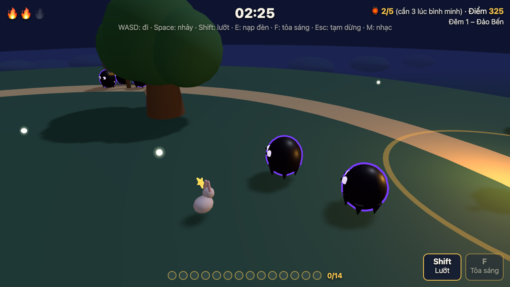

# Đảo Đèn Lồng

> 🎬 **Video demo:** _(link trong GitHub Release v1.0.0)_ · 📦 **Release:** `v1.0.0`



Game 3D góc nhìn thứ ba viết bằng three.js. **Mây**, người giữ đèn nhỏ tuổi đội nón lá, gom đom đóm để thắp và giữ sáng các Đèn Lồng Lớn qua 3 Đêm (**Đảo Bến**, **Đảo Cau**, **Đảo Chuông**) trong khi tránh **Bóng Mực** và **Gió Lạc**. Thắng khi còn sống lúc bình minh và đủ 60 % số đèn còn sáng.

## Yêu cầu hệ thống
Node.js ≥ 20 · macOS hoặc Linux · trình duyệt có WebGL2 (Chrome/Chromium/Firefox/Safari). Lệnh `bench` và `scripts/e2e.mjs` cần **Google Chrome hoặc Chromium** (đặt `CHROME=/đường/dẫn` nếu không tự tìm thấy).

## Cài đặt và chạy (3 lệnh)
```bash
npm install
npm start        # mở http://localhost:5173
npm test         # 75 test: logic, hồi quy Phase 1–3, tất định, bảng xếp hạng, bench, soak
```

## Điều khiển (đổi được trong Cài đặt)
| Phím mặc định | Việc |
|---|---|
| W A S D | Chạy (theo hướng camera) |
| Space | Nhảy |
| Shift | Lướt |
| E | Thắp / thắp lại / châm dầu đèn gần nhất (≤ 2 m) |
| F | Tỏa Sáng (tốn 3 đom đóm) |
| Esc | Tạm dừng: Tiếp tục / Chơi lại Đêm / Cài đặt / Về menu |
| Kéo chuột | Xoay camera · **M** bật/tắt nhạc |

Cài đặt (lưu lại): âm lượng, độ nhạy chuột, **đổi phím cho cả 9 hành động** (báo trùng phím, nút "Khôi phục mặc định"), bảng màu dễ phân biệt, **giảm chuyển động** (tắt rung camera và chớp màn hình), **chữ lớn ×1.25**. Phụ đề hình ảnh cho: Bóng Mực xuất hiện (kèm mũi tên ở mép màn hình), gió sắp thổi, 10 giây cuối, đèn dưới 30 dầu. Toàn bộ chữ giao diện ≥ 18 px ở 1280×720.

## Luật tóm tắt
- Đèn có **dầu** (100, hao 1/giây). Châm dầu: mỗi đom đóm +10 dầu. Hết dầu đèn tắt, **thắp lại chỉ cần 5 đom đóm** (thắp lần đầu cần 10).
- Đèn dầu < 30 mất vùng an toàn; Bóng Mực tìm tới hút 5 dầu/giây.
- Sức chứa 10 + 2 × số lần thắp (tối đa 20). **Thắng** = còn sống lúc bình minh và số đèn sáng ≥ ceil(0.6 × tổng) (3/5, 4/6, 5/7). **Thua** = hết 3 Ngọn Lửa hoặc dưới ngưỡng lúc bình minh.
- **Điểm** (mỗi Đêm): +5 mỗi đom đóm nạp · +100 thắp lần đầu · +40 thắp lại · +5 mỗi Bóng Mực trúng Tỏa Sáng (+15 nếu đang hút dầu) · khi thắng: mỗi đèn sáng +50 + dầu, mỗi Ngọn Lửa +50. Tổng điểm = tổng các Đêm đã thắng.
- **Bảng xếp hạng** (top 10, menu chính): sau Bình Minh hoặc khi thua, nhập tên 3–12 ký tự `[A-Za-z0-9_]` (chữ tiếng Việt có dấu cũng được). Lưu ở `data/leaderboard.json` (còn sau khi tắt mở lại).

## Headless, benchmark, soak (Test Contract v1.3 = [game.contract.json](game.contract.json))
```bash
node src/headless.js --night 2 --seed 4 --bot --snapshot-every 600        # headless, 1 dòng JSON
node scripts/bench.mjs --seed 42 --duration 30 --out bench.json            # bench_cmd (mở Chrome 1280×720, vsync tắt)
node --expose-gc --jitless --max-semi-space-size=1 scripts/soak.mjs --seed 7 --nights 10 --out soak.json   # soak_cmd
node server.js --export-leaderboard out.json                                # run_cmd + xuất bảng xếp hạng
```
- **Bench:** cảnh chuẩn Đêm 1 (200 Bóng Mực wander + 100 đom đóm + 3 đèn sáng, camera bay vòng r=30 m, Y=15, 15 s/vòng, 3 s khởi động). Đã tắt vsync bằng `--disable-gpu-vsync --disable-frame-rate-limit`. Kết quả tự đo trên máy tác giả (Apple M4): **555 FPS trung bình, p1 low 291 FPS, p95 2.7 ms, load 0.6 s** (các lần chạy khác: 548–555 FPS) ([bench.json](bench.json)). Bản bench tắt nhân vật/đạo cụ sáng tạo.
- **Soak:** 10 Đêm trong một tiến trình, 0 crash ([soak.json](soak.json)). **Lưu ý trung thực:** RSS của Node phình ở vài Đêm đầu vì V8 (biên dịch JIT, nới heap) dù heap thật phẳng (~4.5 MB suốt 50 Đêm). Với cờ mặc định tỉ lệ cuối/đầu là **2.04** (trượt ngưỡng 1.2, xem [soak-default-flags.txt](docs/proof/phase4/soak-default-flags.txt)); `soak_cmd` dùng `--jitless --max-semi-space-size=1` để đo được **~1.11**.
- `--out` mặc định ghi cạnh thư mục chạy. Chi tiết số đo: [docs/proof/phase4/README.md](docs/proof/phase4/README.md).

## Kiểm chứng
`npm test` · `node scripts/e2e.mjs` (19 kiểm tra trình duyệt) · `./scripts/proof.sh 4` (sinh lại bằng chứng) · CI `.github/workflows/test.yml`. Bằng chứng từng phase: `docs/proof/phase1..4/`. Spec và giả định: `docs/notes/`. Quyết định thiết kế: `docs/adr/`. Thay đổi: [CHANGELOG.md](CHANGELOG.md). Nhật ký AI + chi phí: [docs/notes/ai_log.md](docs/notes/ai_log.md). Retro: [docs/notes/retro.md](docs/notes/retro.md). Nguồn asset: [CREDITS.md](CREDITS.md). Giấy phép: [LICENSE](LICENSE).

## Sáng tạo của tôi
Chỉ nằm ở lớp hiển thị (`src/web/`), không có trong `src/core/`, **tắt trong cảnh benchmark** và không đổi đầu ra headless:
- **Thỏ Ngọc** cầm đèn ông sao đi theo Mây; **Chú Cuội** dưới cây đa (hình tượng dân gian Việt Nam).
- Chi tiết tuổi thơ: bãi đất 3 ống cống, con diều, nhà mái ngói đỏ; cây cau và cầu tre ở Đảo Cau; chuông vàng trên tháp Đảo Chuông.
- Lời dẫn của **Ông Đăng** mỗi Đêm; đảo sáng dần theo số đèn; lá bay báo gió.
- **Nhạc nền "Đêm Đèn Lồng" tự sáng tác** (sáo ngũ cung, pad, chuông, bass) và mọi hiệu ứng âm thanh tổng hợp bằng WebAudio.

**Bằng chứng phần lõi vẫn đúng:** 75/75 test, trong đó scenario Phase 1 chép nguyên văn từ tag `phase-1` vẫn chạy ([phase1-regression.test.js](tests/phase1-regression.test.js)); test kiến trúc cấm `src/core/` dùng đồ họa/DOM/đồng hồ ([architecture.test.js](tests/architecture.test.js)); headless tất định trên cả 3 Đêm ([determinism.txt](docs/proof/phase4/determinism.txt)).
